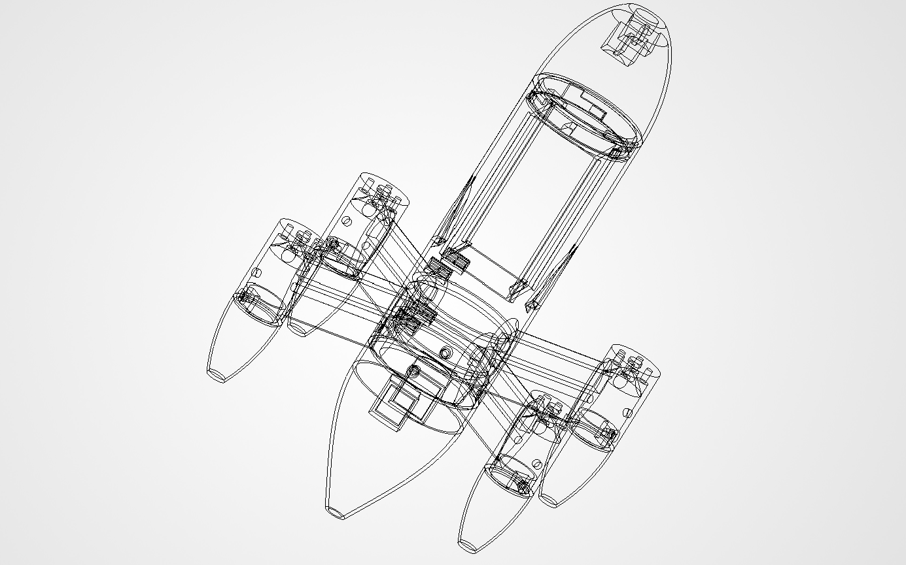

# SpeedUAS: High-Speed Quadcopter (Iteration 1, 6S)

A 5-inch, 6S quadcopter with a streamlined body-of-revolution fuselage. The goal of this first
iteration is to validate the airframe and set a performance baseline for a second one.

| | |
|---|---|
| **Status** | Design v4.5.1 · PLA fit-check printing · CFD meshing in progress, not solved · not assembled or flown |
| **Target** | 160–175 km/h in calm air |
| **Predicted (estimate)** | ~240 km/h from a thrust = drag model using estimated drag and datasheet thrust. Not yet validated by CFD or flight. Geometric pitch speed 251 km/h. |
| **Tools** | SolidWorks · Ansys (SpaceClaim, Fluent Meshing; solver runs pending) · Bambu Studio |
| **Power** | 4× AOS Supernova 2207 1980KV · T-Motor F7 + F55A Pro II · 6S 1300 mAh HV · HQ 5×4.5×3 |

Every number on this page is a calculation or a datasheet value unless it says "measured".

## Design at a glance

- **Fuselage:** Myring body of revolution, D 62 mm. Nose (bayonet, camera), one-piece center tube,
  screw-on tail (M3 into heat-set inserts). Battery forward, flight electronics aft, to keep the
  frontal area small.
- **Arms:** four integral NACA 0024 arms, 38 mm chord, 105 mm to motor axis, 5 mm root fillets,
  4 mm CF spar, airfoil-shaped internal wire channels. A thinner NACA 0018 was considered and
  rejected: slightly less drag, but far less bending stiffness and no room for the spar and wiring.
- **Nacelles:** sized to the 27.6 mm motor, 7 mm motor plate (16 mm bolt circle), screw-on tail caps.
- **Inside:** caged battery, FC/ESC stack mounted across the tube on a printed plate, two NACA
  flush inlets for ESC cooling.
- **Printing:** every part is designed to print without supports.

## Findings so far

1. In the thrust = drag model, top speed is **pitch-speed limited**: ±25 % drag moves it about
   ±4 km/h, while ±8 % pitch speed moves it about ±17 km/h.
2. Motors and nacelles are about half of the estimated drag area, which makes them the biggest
   aerodynamic lever.
3. Datasheet current (54–61 A per motor at full throttle, about 220 A total) means roughly 20 s of
   full throttle on a 1300 mAh pack. To be confirmed on the thrust stand.

## What the first prints taught me

| What went wrong | How it was found | What changed |
|---|---|---|
| Battery modeled from its datasheet size with ~1 mm clearance; the real pack measured 34.9 × 38.7 × 80.7 mm | First fit print: the battery would not fit | Fuselage diameter increased, cage resized to the measured pack |
| Motor bolt pattern drawn as a 16 mm square; the "16" was the bolt circle | First fit print plus caliper measurement | Pattern corrected, nacelles shrunk to the motor |
| Motor plate printed as a ~29 mm unsupported bridge | Printed badly | Funnel-shaped cavity with screw pockets under the plate |
| Motor-lead slot about 1–1.5 mm too far from the arm | Arm test print | Slot moved inboard |

## Not done yet

- **CFD:** geometry prep and meshing are set up; no solver run and no results yet.
- **Mass:** parts have not been weighed, so there is no all-up mass or thrust-to-weight figure.
- **Thrust stand:** designed and printed, not yet run. No thrust data.
- **Flight:** the aircraft has not been assembled or flown.

## Next

1. Fit print of the current center tube, with a pass/fail check of the bore, stack plate, insert
   holes and tail fit.
2. Weigh and measure every part to replace datasheet masses with measured ones.
3. Finish the volume mesh, solve the bare airframe, and replace the estimated drag area with a
   computed one.

## Repository layout

These folders are placeholders. They are empty until the work in them is finished and checked.

| Folder | What will go here |
|---|---|
| `docs/` | Design log, architecture, bill of materials |
| `cad/images/` | CAD renders and screenshots, labelled as renders |
| `cad/reference/` | Reference assembly with vendor component models |
| `cad/vendor/` | Sources and licenses for third-party models (the models themselves are not stored here) |
| `analysis/` | Top-speed model, mass budget, bench-test analysis |
| `cfd/` | Setup notes, mesh and solver records, results |
| `test/procedures/` | Test procedures |
| `test/reports/` | Test reports |
| `test/data/` | Raw bench logs |
| `firmware/` | Thrust stand logger |
| `manufacturing/` | Print settings |
| `media/` | Figures |

More context: [adlerkiely-afk.github.io](https://adlerkiely-afk.github.io)
