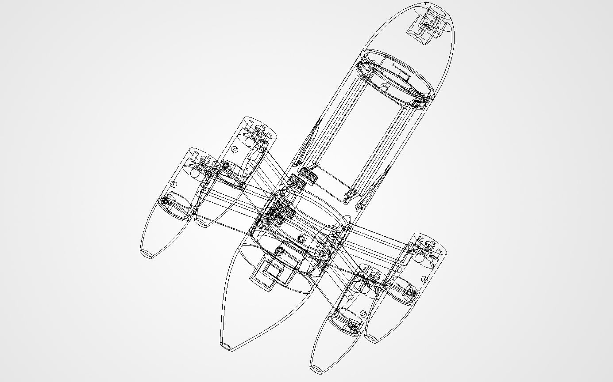

# SpeedUAS: High-Speed Quadcopter (Iteration 1, 6S)

I'm building a 5-inch, 6S quadcopter shaped like a rocket: a streamlined body-of-revolution fuselage
with airfoil arms. This first iteration is about proving out the airframe and getting a performance
baseline, so the second one can go faster.

| | |
|---|---|
| Status | Design v4.5.1, PLA fit-check prints, CFD meshing (not solved yet), not assembled or flown |
| Target | 160–175 km/h in calm air |
| Predicted | ~240 km/h from a thrust = drag model with estimated drag and datasheet thrust. Not checked by CFD or flight yet. Geometric pitch speed is 251 km/h. |
| Tools | SolidWorks, Ansys (SpaceClaim, Fluent Meshing), Bambu Studio |
| Power | 4x AOS Supernova 2207 1980KV, T-Motor F7 + F55A Pro II, 6S 1300 mAh HV, HQ 5x4.5x3 |

Unless a number says "measured", it's a calculation or a datasheet value.

## The design

- Fuselage: Myring body of revolution, 62 mm diameter. Nose with a bayonet mount and the camera, a
  one-piece center tube, and a tail that screws on with M3 screws into heat-set inserts. The battery is
  up front and the electronics are in back to keep the frontal area small.
- Arms: four NACA 0024 arms built into the airframe, 38 mm chord, 105 mm out to the motor axis, 5 mm
  root fillets, a 4 mm carbon spar, and airfoil-shaped wire channels inside. I looked at a thinner NACA
  0018 too. It has a little less drag, but way less bending stiffness and no room for the spar and
  wires, so I stuck with the 0024.
- Nacelles: sized to the 27.6 mm motor, 7 mm motor plate (16 mm bolt circle), screw-on tail caps.
- Inside: a cage for the battery, the FC/ESC stack across the tube on a printed plate, and two NACA
  flush inlets to cool the ESC.
- Printing: every part prints without supports.

## What the numbers say so far

1. In my thrust = drag model the top speed is limited by pitch speed. Changing drag by 25% only moves
   it about 4 km/h, but changing pitch speed by 8% moves it about 17 km/h.
2. The motors and nacelles are about half of the estimated drag area, so that's where the biggest
   aero gains are.
3. At the datasheet current (54–61 A per motor at full throttle, about 220 A total) a 1300 mAh pack
   only lasts about 20 s at full throttle. I'll check that on the thrust stand. It's why I rewrote the
   endurance requirement (see Rev E).

## What the first prints taught me

| What went wrong | How I found it | What I changed |
|---|---|---|
| I modeled the battery from its datasheet with ~1 mm of clearance. The real pack measured 34.9 x 38.7 x 80.7 mm | First fit print, the battery didn't fit | Made the fuselage bigger and resized the cage to the measured pack |
| I drew the motor bolt pattern as a 16 mm square, but the "16" was the bolt circle | First fit print plus calipers | Fixed the pattern and shrunk the nacelles down to the motor |
| The motor plate printed as a ~29 mm unsupported bridge | It printed badly | Replaced it with a funnel-shaped cavity with screw pockets |
| The motor-lead slot was about 1–1.5 mm too far from the arm | Arm test print | Moved the slot inboard |

## Still to do

- CFD: geometry and meshing are set up. I still need to run the solver.
- Mass: I haven't weighed the parts yet, so there's no all-up mass or thrust-to-weight number.
- Thrust stand: designed and printed, not run yet, so no thrust data.
- Flight: not assembled or flown yet.

## Next

1. Fit print the current center tube and check the bore, stack plate, insert holes and tail fit.
2. Weigh and measure every part so the mass budget uses real numbers instead of datasheet ones.
3. Finish the volume mesh, solve the bare airframe, and swap my estimated drag area for a computed one.

## Repo layout

Some folders are still empty until the work in them is done and checked. The thrust stand firmware,
analysis code, test procedures and requirements are in, but none of the bench stuff has been run on
hardware yet.

| Folder | What goes here |
|---|---|
| `docs/` | Requirements, design log, architecture, parts list |
| `cad/images/` | CAD renders and screenshots |
| `cad/reference/` | Reference assembly with vendor component models |
| `cad/vendor/` | Sources and licenses for third-party models (not the models themselves) |
| `analysis/` | Top-speed model, mass budget, bench-test analysis |
| `cfd/` | Setup notes, mesh and solver records, results |
| `test/procedures/` | Test procedures |
| `test/reports/` | Test reports |
| `test/data/` | Raw bench logs |
| `firmware/` | Thrust stand logger |
| `manufacturing/` | Print settings |
| `media/` | Figures |

More about me and my other projects: [adlerkiely-afk.github.io](https://adlerkiely-afk.github.io)
